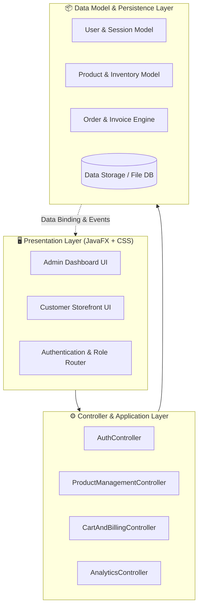

<div align="center">

# 🛒 Online Store — JavaFX Dynamic Store Management System

[](https://www.oracle.com/java/)
[](https://openjfx.io/)
[](https://developer.mozilla.org/en-US/docs/Web/CSS)
[](#)
[](#)

<p align="center">
  <b>A comprehensive, desktop-grade E-Commerce & Inventory Management application built using JavaFX and custom modern CSS styling.</b>
  <br />
  Featuring dedicated role-based portals for Administrators and Customers with intuitive point-of-sale and catalog operations.
</p>

---

</div>

## 📌 Overview

**Online Store** is an enterprise-pattern desktop solution designed to streamline retail operations. It bridges the gap between customer purchasing experiences and backend administrator inventory management through a responsive JavaFX graphical interface.

---

## 🏗️ 2D/3D System Architecture

The project follows a modular **Model-View-Controller (MVC)** layered pattern:



---

## ✨ Key Features

### 👑 Administrator Dashboard
- **Product Lifecycle Management**: Add, update, archive, and delete product listings with instant table updates.
- **Stock Tracking & Alerts**: Real-time stock status monitoring to prevent out-of-stock scenarios.
- **Sales & Orders Overview**: View completed customer checkouts and revenue totals.
- **Category & Pricing Rules**: Group products by tags, categories, and manage discount rates.

### 🛍️ Customer Experience
- **Interactive Product Catalog**: Grid view with high-res thumbnails, product specifications, and pricing.
- **Real-Time Shopping Cart**: Add to cart, adjust quantities, calculate VAT/taxes dynamically.
- **Automated Invoice Generation**: Instant purchase receipt and checkout summary.

---

## 📂 Project Directory Structure

```plaintext
Online_Store/
├── 📁 src/
│   ├── 📁 application/         # Application entry point & Stage loader
│   ├── 📁 controllers/         # Event handlers and UI logic (Admin / Customer)
│   ├── 📁 models/              # Product, User, Cart, and Order data structures
│   ├── 📁 views/               # FXML views & layouts
│   └── 📁 styles/              # Custom CSS styling (dark/light themes)
├── 📁 bin/                     # Compiled bytecode binaries
├── 📄 build.fxbuild            # JavaFX build and deployment packaging configuration
├── 📄 .project                 # IDE workspace project metadata
└── 📄 README.md                # Project documentation
```

---

## 🚀 Getting Started

### Prerequisites
- **JDK 17+** (Recommended: Eclipse Temurin or Oracle JDK)
- **JavaFX SDK** matching your JDK version
- IDE: **Eclipse**, **IntelliJ IDEA**, or **VS Code**

### Running the Application

1. **Clone the repository:**
   ```bash
   git clone https://github.com/MominRifat/Online_Store.git
   cd Online_Store
   ```

2. **Run via IDE (Eclipse / IntelliJ):**
   - Import as an existing Java Project.
   - Add the JavaFX SDK library to the project Build Path.
   - Add the following VM arguments in your Run Configuration:
     ```bash
     --module-path "/path/to/javafx-sdk/lib" --add-modules javafx.controls,javafx.fxml
     ```
   - Run `src/application/Main.java`.

---

## 👨‍💻 Author

**Momin Rifat**  
- GitHub: [@MominRifat](https://github.com/MominRifat)  
- Location: Dhaka, Bangladesh
