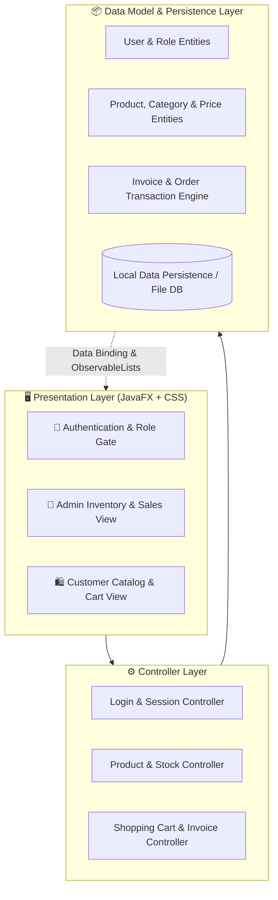

<div align="center">

# 🛒 Online Store — JavaFX Dynamic Store Management System

[](https://www.oracle.com/java/)
[](https://openjfx.io/)
[](https://developer.mozilla.org/en-US/docs/Web/CSS)
[](#)
[](#)
[](#)

<p align="center">
  <b>A desktop-grade point-of-sale (POS) and e-commerce inventory management system built with JavaFX and modern custom CSS.</b>
  <br />
  Featuring dual portals for Administrators and Customers, real-time cart calculations, inventory tracking, and dynamic receipts.
</p>

[📌 About the Project](#-about-the-project) • [🛠️ Tech Stack](#️-comprehensive-tech-stack) • [🏗️ Architecture](#️-2d3d-system-architecture) • [🚀 How to Run](#-complete-how-to-run--installation-guide) • [✨ Features](#-key-features)

---

</div>

## 📌 About the Project

**Online Store** is an enterprise-pattern Java desktop application engineered to eliminate the complexities of retail stock control and customer checkout. 

Operating on a decoupled **Model-View-Controller (MVC)** foundation, the software allows store managers to monitor live stock thresholds, update pricing tiers, and generate sales analytics, while customers enjoy an intuitive, visual shopping experience with instant cart updates and receipt summaries.

---

## 🛠️ Comprehensive Tech Stack

| Domain | Technology | Version / Spec | Purpose & Responsibility |
| :--- | :--- | :--- | :--- |
| **Language** | **Java (JDK)** | `17+` (LTS) | Core application logic, multithreading, and OOP architecture |
| **GUI Framework** | **JavaFX** | `17+` / `21+` | Stage & Scene management, FXML layouts, Observable collections |
| **Styling & Theme** | **CSS3** | Modern JavaFX CSS | Dark/light glassmorphic card styling, button hover physics |
| **Architecture Pattern** | **MVC Pattern** | Native | Clear separation between Models, Views (FXML), and Controllers |
| **Data Persistence** | **File I/O / Serialization** | Java Standard | Persistent product catalogues, user session records, and transaction logs |
| **Build Tooling** | **Eclipse / IntelliJ** | Native (`.project`, `build.fxbuild`) | Automated classpath and module configuration |

---

## 🏗️ 2D/3D System Architecture



---

## ✨ Key Features

### 👑 Administrator Control Center
- **Product Lifecycle Operations**: Add new items with image thumbnails, edit prices, set descriptions, and archive out-of-stock items.
- **Automated Stock Alerts**: Real-time notifications when product inventory falls below minimum safety thresholds.
- **Sales Analytics Dashboard**: Daily and monthly total revenue computation with itemized transaction logs.

### 🛍️ Customer Experience Portal
- **Interactive Grid Catalog**: Responsive product browsing with instant category filtering and search.
- **Live Dynamic Shopping Cart**: Real-time subtotal, discount, VAT, and grand total calculations.
- **Instant Printable Invoices**: Formatted checkout summary ready for customer records.

---

## 📂 Repository Directory Layout

```plaintext
Online_Store/
├── 📁 src/
│   ├── 📁 application/         # Application entry point (Main.java) and Scene Router
│   ├── 📁 controllers/         # Event handlers for Admin and Customer interfaces
│   ├── 📁 models/              # Product, CartItem, User, and Invoice data structures
│   ├── 📁 views/               # FXML view layouts (AdminView.fxml, StoreView.fxml)
│   └── 📁 styles/              # CSS stylesheets (application.css, dark-theme.css)
├── 📁 bin/                     # Compiled bytecode class files
├── 📄 build.fxbuild            # JavaFX packaging and build parameters
├── 📄 .project                 # Eclipse project metadata
├── 📄 .classpath               # Classpath dependencies and library references
└── 📄 README.md                # Comprehensive project documentation
```

---

## 🚀 Complete How-To-Run & Installation Guide

### 1. Prerequisites
Ensure you have the following installed on your machine:
- **Java Development Kit (JDK 17 or higher)**: [Download JDK](https://adoptium.net/)
- **JavaFX SDK (version 17 or higher)**: [Download JavaFX SDK](https://gluonhq.com/products/javafx/)
- Your preferred IDE: **Eclipse IDE**, **IntelliJ IDEA**, or **VS Code**

---

### 2. Running via Eclipse IDE (Recommended)

1. **Clone the repository:**
   ```bash
   git clone https://github.com/MominRifat/Online_Store.git
   ```
2. **Import into Eclipse:**
   - Open Eclipse > **File** > **Import** > **General** > **Existing Projects into Workspace**.
   - Browse and select the `Online_Store` folder > Click **Finish**.
3. **Configure JavaFX User Library:**
   - Go to **Window** > **Preferences** > **Java** > **Build Path** > **User Libraries**.
   - Click **New**, name it `JavaFX`, and click **Add External JARs**.
   - Select all `.jar` files inside your downloaded JavaFX SDK `lib` folder.
4. **Set VM Arguments:**
   - Right-click `Main.java` > **Run As** > **Run Configurations...**
   - Click the **Arguments** tab > In **VM arguments**, enter:
     ```bash
     --module-path "C:\path\to\javafx-sdk\lib" --add-modules javafx.controls,javafx.fxml
     ```
   - Replace `C:\path\to\javafx-sdk\lib` with your actual JavaFX SDK path.
5. **Run the Application:**
   - Click **Run** to launch the GUI window!

---

### 3. Running via IntelliJ IDEA

1. Open IntelliJ IDEA > **Open** > Select `Online_Store`.
2. Go to **File** > **Project Structure** > **Libraries** > Click **+** > Select your JavaFX `lib` folder.
3. Edit Run Configuration:
   - Click **Add New Configuration** > **Application**.
   - Set **Main class**: `application.Main`
   - Under **Modify options**, select **Add VM options** and enter:
     ```bash
     --module-path "path/to/javafx-sdk/lib" --add-modules javafx.controls,javafx.fxml
     ```
4. Click **Run** (`Shift + F10`).

---

### 4. Running via Terminal / Command Line

```bash
# 1. Compile source files:
javac --module-path "path/to/javafx-sdk/lib" --add-modules javafx.controls,javafx.fxml -d bin src/application/*.java

# 2. Execute application:
java --module-path "path/to/javafx-sdk/lib" --add-modules javafx.controls,javafx.fxml -cp bin application.Main
```

---

## 👨‍💻 Author

**Momin Rifat**  
- GitHub: [@MominRifat](https://github.com/MominRifat)  
- Focus: Software Engineering & Object-Oriented Development  
- Location: Dhaka, Bangladesh
